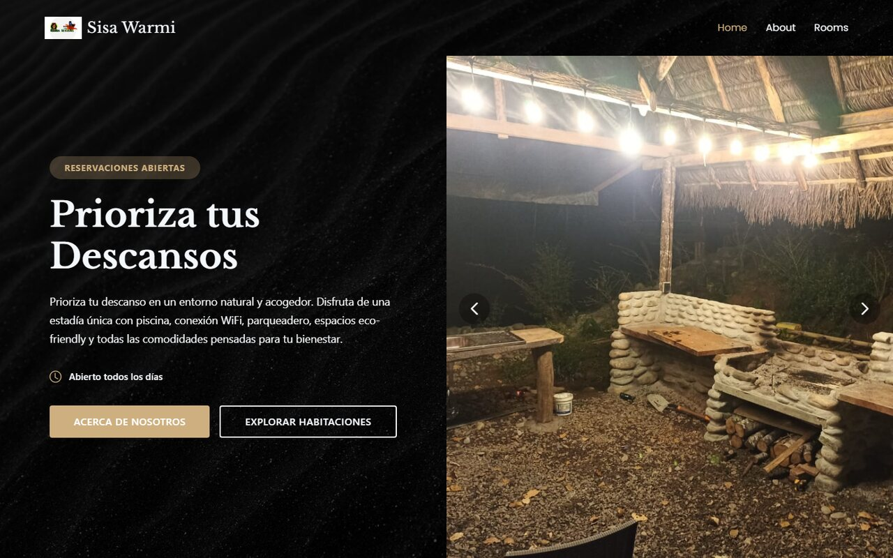
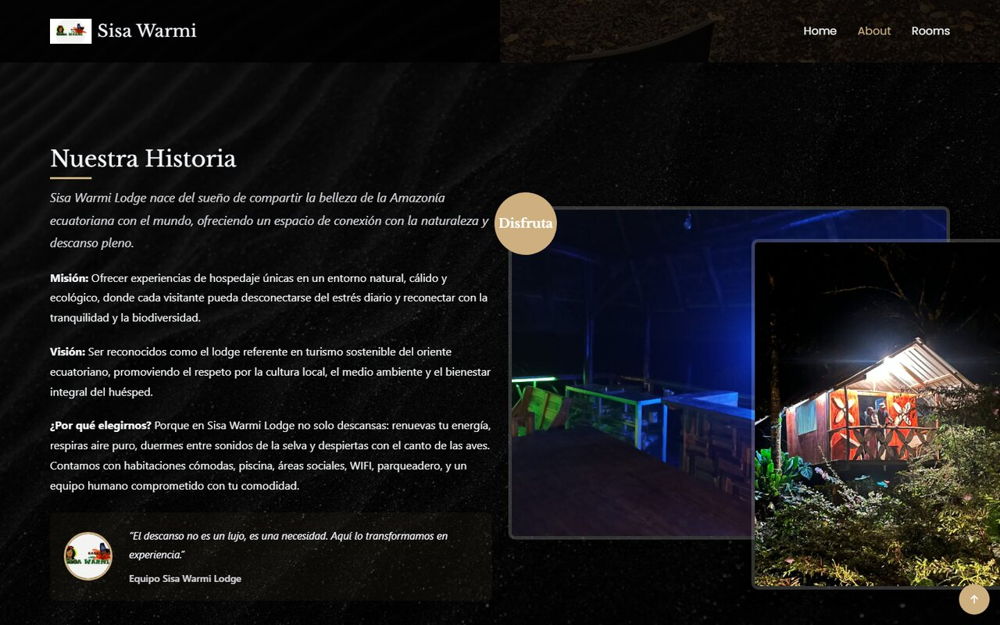
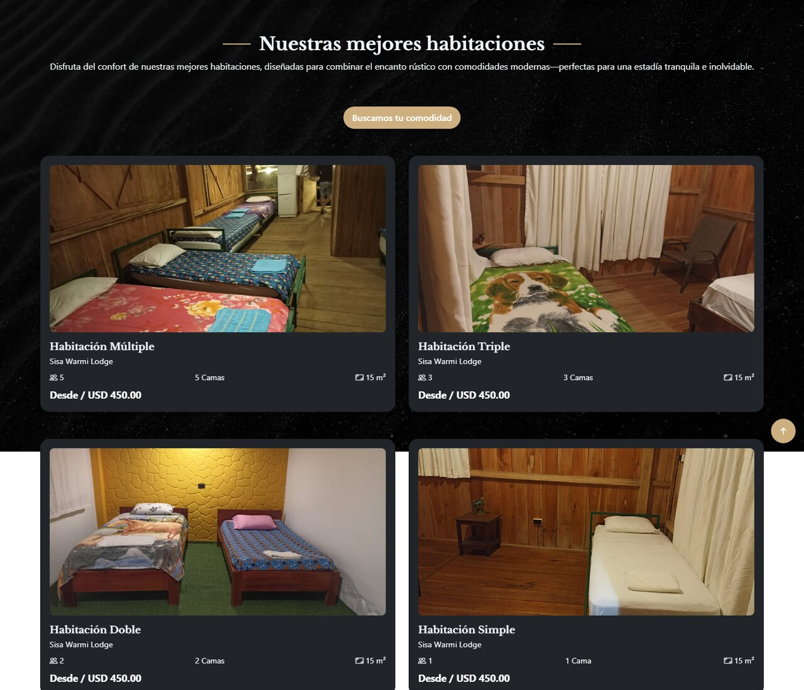
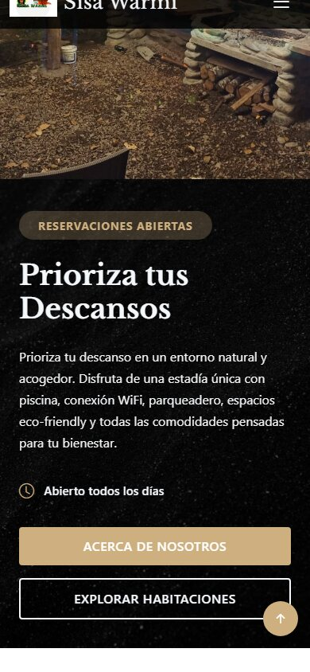

<div align="center">

# Sisa Warmi Lodge

### Sitio web para un hospedaje turístico, con galería, habitaciones y contacto

[](https://developer.mozilla.org/docs/Web/HTML)
[](https://getbootstrap.com/)
[](https://developer.mozilla.org/docs/Web/JavaScript)
[](#)
[](#)

**[Ver sitio en vivo](https://adrizzx.github.io/Sisa-Warmi/)**



</div>

---

## Descripción

Sitio web desarrollado y **entregado a una empresa de turismo** para el hospedaje Sisa Warmi. Presenta la historia del lugar, sus habitaciones y servicios con una experiencia visual centrada en las fotografías del establecimiento, y pone al huésped a un clic del contacto.

## Capturas

<table>
  <tr>
    <td width="50%"></td>
    <td width="50%"></td>
  </tr>
  <tr>
    <td align="center"><sub>Nuestra historia</sub></td>
    <td align="center"><sub>Habitaciones</sub></td>
  </tr>
</table>

<div align="center">
  
  <br><sub>Vista en dispositivo móvil</sub>
</div>

## Características

- Diseño **responsive** con Bootstrap 5.
- Carrusel principal con **Swiper**, animaciones de entrada con **AOS** y galería filtrable con **Isotope**.
- Secciones de inicio, historia, habitaciones, galería y contacto.
- Formularios de contacto y reserva.
- Sitio estático optimizado para publicación directa.

## Estructura

```
├── index.html       Contenido del sitio
├── assets/          CSS, JavaScript, imágenes y librerías (Bootstrap, Swiper, AOS, Isotope)
├── public/images/   Fotografías del hospedaje
└── forms/           Formularios de contacto y reserva
```

## Ejecución local

```bash
npx serve .
```

## Créditos

- Diseño, adaptación y desarrollo: **Marco Adrián Padilla Triviño** ([@Adrizzx](https://github.com/Adrizzx)).
- Construido a partir de la plantilla [NiceRestaurant](https://bootstrapmade.com/nice-restaurant-bootstrap-template/) de BootstrapMade, adaptada en contenido, estructura e imágenes (ver `CREDITOS-PLANTILLA.txt`).
